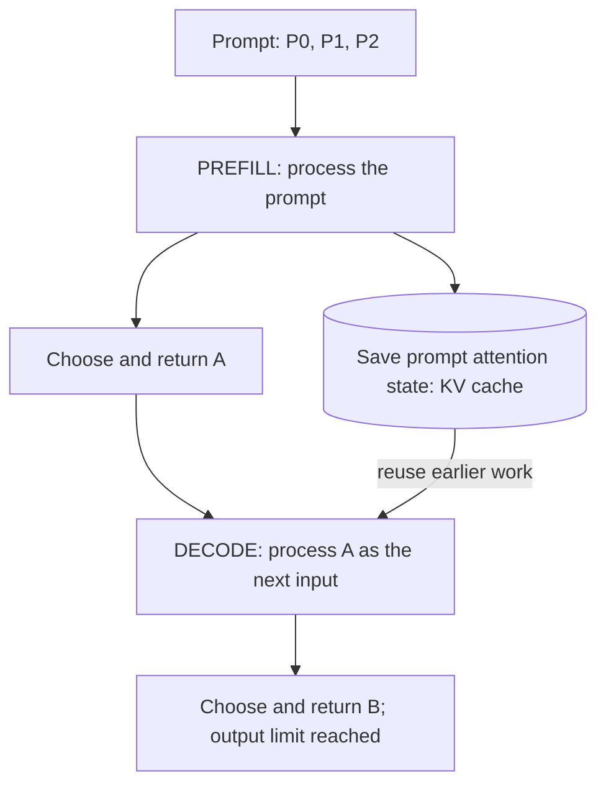
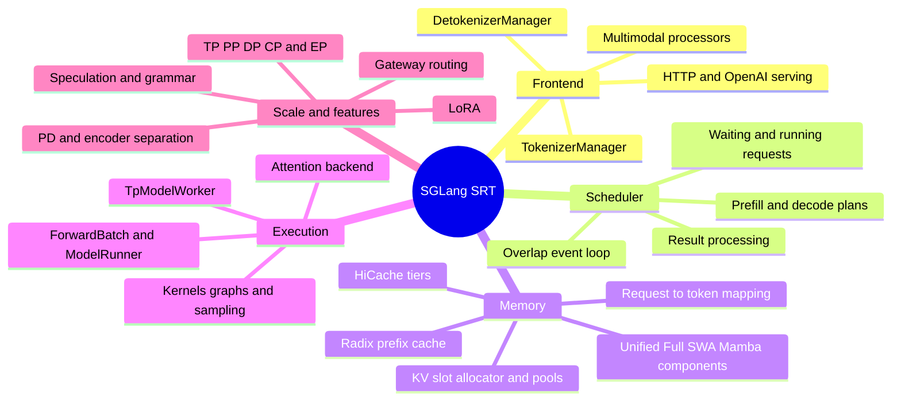
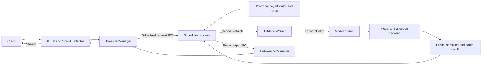

# SGLang architecture: from request to token

[Index and revision](README.md) | [Deep dives](deep-dives.md) |
[Source labs](source-labs.md)

## Start here: what happens after you press Send?

SGLang has to do more than call a neural network. It must remember **who asked**,
decide **whose work runs next**, keep **useful model state**, and deliver an
answer without mixing requests.

> The simplest mental model: receive a request, run a model step, save its
> progress, and repeat until the request is finished.

On your first read, ignore distributed execution, speculative decoding, and
specialized caches. Follow **one request on one GPU**. The full source reference
is folded below for your second pass.

### Watch two tokens being generated

Suppose the prompt has three tokens, which we will call `P0`, `P1`, and `P2`.
Suppose the model then chooses `A`, followed by `B`, and the request stops after
those two output tokens. These are teaching symbols, not real tokenizer output
or a prediction from a particular model.



**Prefill** means processing the prompt. **Decode** means continuing generation
using saved context. The **KV cache** is saved attention state for earlier
positions, not a cache of finished text answers.

| Model step | New input processed | Saved attention state afterward | Newly chosen output |
|---|---|---|---|
| Prefill | `P0, P1, P2` | State for `P0, P1, P2` | `A` |
| First decode step | `A` | State for `P0, P1, P2, A` | `B` |

Notice the one-step offset: choosing `B` does **not** mean the model has already
processed `B` as an input. That happens only if generation continues.

### Give each job a name

Do not memorize every class. Start with these four jobs and follow one request
through them:

| Job in plain language | Why it exists | SGLang code name |
|---|---|---|
| Receive input and keep the response waiting | The client must not block every other request | [TokenizerManager](../python/sglang/srt/managers/tokenizer_manager.py) |
| Decide the next batch of work | Requests compete for computation and memory | [Scheduler](../python/sglang/srt/managers/scheduler.py) |
| Prepare tensors and run the model | The GPU needs token positions, state locations, and model inputs | [TP worker](../python/sglang/srt/managers/tp_worker.py) and [ModelRunner](../python/sglang/srt/model_executor/model_runner.py) |
| Turn output tokens into a response | Model token IDs are not yet streamed text | [DetokenizerManager](../python/sglang/srt/managers/detokenizer_manager.py), then the frontend |

Saved KV supports the middle two jobs. The scheduler decides which state may
be reused and reserved; the selected attention path consumes the state during
the model step.

### Why add scheduling and overlap?

Now introduce a second request. A is waiting for one next token; B has a long
new prompt. Letting B occupy the GPU for too long can make A's stream pause.
The scheduler limits and combines work to balance this tradeoff.

Overlap solves a different problem: while the GPU computes, the CPU may have
independent preparation or result-handling work to do. That saves idle time,
but only if it does not overwrite state the GPU is still reading.

**Try first:** after the prefill above returns `A`, should the next forward
receive the entire prompt again, or just the newly chosen token?

<details>
<summary>Check your understanding</summary>

In the ordinary cached decode path, the new input is `A`. Attention reuses the
saved state for `P0, P1, P2`. The old context still matters; it is represented
by cached state rather than repeated new input tokens.

This does not mean the decode step reads only one token's worth of memory.
Attention can read a large cached context.

</details>

### Now connect the picture to code

Read only this short route on the first source pass:

1. [`TokenizerManager.generate_request`](../python/sglang/srt/managers/tokenizer_manager.py):
   find the dispatch and response-wait steps. There is no model forward here.
2. [`Scheduler.event_loop_normal`](../python/sglang/srt/managers/scheduler.py):
   find receive, choose batch, run, and process result.
3. [`TpModelWorker.forward_batch_generation`](../python/sglang/srt/managers/tp_worker.py):
   find the conversion to `ForwardBatch` and the model-runner call.

Only then open [lesson 5's packed-token example](../../vllm/learning/code-first-05-batch.md)
or the detailed reference below.

**Compare with vLLM:** the model still processes a prompt and then continues
generation. The main difference is the control structure: vLLM's engine core
turns per-request token progress into scheduler output for its workers. See
the [same small story in vLLM](../../vllm/learning/vllm-architecture.md#start-here-the-same-model-work-different-control-structure).

## Optional reference: the complete source map

<details>
<summary>Open exact source boundaries, full diagrams, and advanced paths</summary>

## 1. Project mind map



## 2. Baseline serving flow



This is the ordinary Python serving mental model, not a fixed process count for
every mode. TP/PP/DP, encoder separation, multi-tokenizer, embedding, and
alternative entrypoints change topology or bypass portions of the output path.

The [engine launcher](../python/sglang/srt/entrypoints/engine.py) documents the
baseline tokenizer/main-process, scheduler subprocess, and detokenizer subprocess
arrangement. Inspect launch configuration before counting replicas or ranks.

## 3. Request trace with exact source entry points

| Phase | Read | What crosses the boundary |
|---|---|---|
| HTTP protocol | [HTTP server](../python/sglang/srt/entrypoints/http_server.py), [OpenAI chat adapter](../python/sglang/srt/entrypoints/openai/serving_chat.py) | HTTP body -> internal generation request |
| Normalize/tokenize | [Tokenizer manager](../python/sglang/srt/managers/tokenizer_manager.py), `TokenizerManager.generate_request` | Normalized input -> tokenized request and per-request state |
| IPC schema | [IO structures](../python/sglang/srt/managers/io_struct.py) | Request IDs, token/media/sampling data, control/output messages |
| Scheduling | [Scheduler](../python/sglang/srt/managers/scheduler.py), `get_next_batch_to_run` | Waiting/running state -> next-batch plan |
| Batch representation | [Schedule batch](../python/sglang/srt/managers/schedule_batch.py), `Req`, `ScheduleBatch` | Request-local and scheduler-owned state |
| Worker boundary | [TP worker](../python/sglang/srt/managers/tp_worker.py), `forward_batch_generation` | `ScheduleBatch` -> `ForwardBatch` |
| Forward metadata | [Forward batch](../python/sglang/srt/model_executor/forward_batch_info.py), `ForwardBatch.init_new` | Flattened inputs, positions, cache locations and execution metadata |
| Model execution | [Model runner](../python/sglang/srt/model_executor/model_runner.py), `forward` | Device inputs -> logits/hidden results and execution metadata |
| Attention | [RadixAttention layer](../python/sglang/srt/layers/radix_attention.py), [backends](../python/sglang/srt/layers/attention) | Q/K/V plus forward/cache metadata -> attention output |
| Result/streaming | [Batch result processor](../python/sglang/srt/managers/scheduler_components/batch_result_processor.py), [output streamer](../python/sglang/srt/managers/scheduler_components/output_streamer.py) | Sampled/accepted tokens -> request updates and output messages |
| Detokenize | [Detokenizer](../python/sglang/srt/managers/detokenizer_manager.py) and tokenizer manager | Token updates -> response chunks |

Do not equate the `RadixAttention` layer with the radix-tree implementation.
The layer is an attention execution interface; prefix lookup and ownership are
cache/scheduler concerns.

## 4. TokenizerManager is more than tokenization

In the inspected `generate_request` path:

1. Ensure the output-handling loop is active.
2. Normalize batch arguments, priority, and request state.
3. Respect pause/update synchronization and validate/resolve LoRA.
4. Tokenize/process and dispatch the request.
5. Await response updates and yield them to the caller.
6. On failure, distinguish states never dispatched from requests that require
   scheduler-side abort/cleanup.

That last distinction prevents frontend validation failures from leaking
request state while avoiding silent abandonment of already-dispatched work.
An async generator completing is not, by itself, proof that every GPU resource
has been reclaimed.

## 5. Normal loop versus overlap loop

Read the two loops in [scheduler](../python/sglang/srt/managers/scheduler.py).

The normal loop is approximately:

```text
ingest -> get next plan -> run batch -> process result -> repeat
```

The overlap loop allows CPU work and device work to overlap. It keeps a result
queue, can process the previous batch while the current forward is outstanding,
and has explicit cases where overlap is disabled.

Important details in this checkout:

- `get_next_batch_to_run` returns a plan carrying both the batch to execute and
  the resulting running-batch state.
- Completed prefill work can merge into the running decode batch; partially
  chunked requests need separate treatment.
- `run_batch` coordinates schedule/forward streams and forward-state isolation.
- A write-after-read barrier protects shared data before result processing
  mutates it.
- Some sampling depends on the previous result, such as grammar advancement,
  and is ordered accordingly.

**Invariant:** CPU preparation must not overwrite host/device metadata that an
in-flight forward is still reading. "Asynchronous" is not a license to remove
barriers. Measure the critical path before changing synchronization.

The specialized PD and PP loops are separate paths. Understand the baseline
before following them; do not assume every feature composes with overlap.

## 6. Memory ownership is layered

Start with [memory subsystem overview](../python/sglang/srt/mem_cache/README.md),
then verify actual file locations in this revision.

| Layer | Responsibility | Source |
|---|---|---|
| Request mapping | Map request positions to cache locations | [Memory pools](../python/sglang/srt/mem_cache/memory_pool.py), `ReqToTokenPool` |
| Allocation policy | Calculate per-batch needs and output cache locations | [Allocation](../python/sglang/srt/mem_cache/allocation.py) |
| Slot allocator | Hand out/reclaim indices under pool rules | [Allocators](../python/sglang/srt/mem_cache/allocator) |
| Device backing | Store K/V or recurrent state in concrete layouts | [Memory pools](../python/sglang/srt/mem_cache/memory_pool.py), [hybrid pools](../python/sglang/srt/mem_cache/hybrid_cache) |
| Prefix index | Find reusable state and determine eviction eligibility | [Radix cache](../python/sglang/srt/mem_cache/radix_cache.py), [unified cache](../python/sglang/srt/mem_cache/unified_radix_cache.py) |
| Host/storage tier | Move and retain reusable state outside device memory | [Host pools](../python/sglang/srt/mem_cache/pool_host), [storage](../python/sglang/srt/mem_cache/storage) |

The overview includes intended organizational structure. In the inspected tree,
many device pool classes still live in the large memory-pool module; do not
assume every planned directory move has already happened.

## 7. Configuration is part of reproducibility

The inspected [runtime context](../python/sglang/srt/runtime_context.py) separates:

- raw startup configuration for provenance;
- published resolved namespace bags;
- runtime flags;
- resources such as streams and buffers;
- per-forward state;
- configured topology and live parallel groups.

The launcher performs resolution and publishes the tokenizer role before
runtime consumers read resolved bags. Other process entries establish their
own process-local context. Changing a parent process's bag is not a distributed
configuration broadcast.

For debugging, record **effective configuration**, model revision, selected
backend, and rank topology. The raw command line alone may miss model- or
hardware-driven resolution. A value specific to a draft runner is also not
necessarily the target runner's resolved value.

## 8. Where the scope expands

- [Multimodal processors](../python/sglang/srt/multimodal/processors) add media
  processing and feature/position alignment.
- [Disaggregation](../python/sglang/srt/disaggregation) adds transfer, readiness,
  and ownership state machines.
- [Speculative execution](../python/sglang/srt/speculative) changes proposal,
  verification, accepted-token, and cache lifetimes.
- [LoRA](../python/sglang/srt/lora) adds adapter residency and execution state.
- [Distributed layers](../python/sglang/srt/distributed) and
  [MoE layers](../python/sglang/srt/layers/moe) add collective ordering.

All of these still need explicit owners, state transitions, and cleanup.
The [deep dives](deep-dives.md) explain the most important invariants.

</details>

**Next:** [SGLang implementation deep dives](deep-dives.md).
