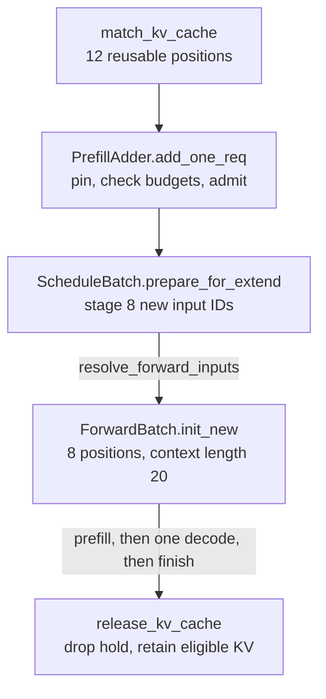

# SGLang implementation deep dives

[Architecture](architecture.md) | [Source labs](source-labs.md) |
[Shared theory](../../vllm/learning/01-foundations.md)

## A worked two-request story

Think of a finished request leaving its working notes on a shelf. The next
request can borrow those notes without keeping the first request alive. But
before starting work, it must protect the notes from being reclaimed.

Start with an empty cache. A's prompt is `P0..P19`. **After A finishes**, B
arrives with `P0..P11, U12..U19`, where `U12 != P12`. These names stand for
token IDs, not words. Both requests use greedy generation and produce exactly
two output tokens, named `A0, A1` and `B0, B1`; assume no earlier stop.
Use ordinary dense, full-attention text generation: no prompt logprobs,
media, LoRA, speculation, hybrid state, sessions, or host offload. The requests
share the same cache namespace, insertion is enabled, and nothing is evicted
between them.

**Selected source path, not a universal default:** at local revision
`5eda6b7e674458c0c01f93801012b6ff6c15064e`,
[`default_radix_cache_factory` / `create_unified_radix_cache`](../python/sglang/srt/mem_cache/registry.py)
lead this built-in dense case to a FULL-only `UnifiedRadixCache`. We deliberately
read its **Python** `UnifiedTreeCore`, selected by the
[lab fixture's `_TREE_CORE_TEST_BACKEND`](../test/registered/unit/mem_cache/test_unified_radix_cache_unittest.py).
An actual engine resolves its core through
[`select_tree_core_backend`](../python/sglang/srt/mem_cache/unified_cache/tree_core_registry.py);
do not assume every installation executes the Python walk.

Page size **4 is illustrative geometry**, not a GPU launch recommendation.
Assume sufficient capacity and an input/chunk budget allowing B's eight new
prompt positions in one step. A's prefill row below totals any chunks it needed.
Count useful completed model work, not padded rows or overlapped lookahead.

| Point in the serial story | Newly computed prompt positions | Useful KV positions for this request | Cache state |
|---|---:|---:|---|
| A completes prefill and chooses `A0` | 20 | 20 | Its computed prompt can be checkpointed and protected |
| A feeds `A0`, chooses `A1`, then finishes | 0 | 21 before release | 20 page-aligned prompt positions remain reusable, with no live request holding them |
| B matches and is admitted | 0 | 12 matched, no new forward yet | B reacquires protection of `P0..P11`; A is already finished |
| B prefills `U12..U19` and chooses `B0` | 8 | `12 + 8 = 20` | Three shared pages plus two new suffix pages on B's path |
| B feeds `B0`, chooses `B1`, then finishes | 0 | 21 before release | With no eviction, the tree retains `12 + 8 + 8 = 28` distinct prompt positions, all unheld |



Read the arrows as **changes of responsibility**, not GPU kernels or a timing
chart. A hit answers *what is reusable*; admission answers *what can safely run*;
forward metadata answers *which positions and locations this execution uses*.
Here is the source proof for the table and those boundaries.

### Match: a valid prefix is not permission to allocate

[`Req.init_next_round_input` / `_compute_max_prefix_len`](../python/sglang/srt/managers/schedule_batch.py)
cap this lookup at `input_len - 1 = 19`.
[`match_kv_cache`](../python/sglang/srt/mem_cache/common.py) adopts the result into
`req.prefix_len` and the node handles. Through
[`UnifiedRadixCache.match_prefix`](../python/sglang/srt/mem_cache/unified_radix_cache.py),
[`UnifiedTreeCore.match_prefix` / `_match_prefix_helper`](../python/sglang/srt/mem_cache/unified_cache/unified_tree_core.py)
page-align the key to 16 positions, then find only 12 equal positions before
the divergent page. [`RadixKey.match_at` / `child_key_at`](../python/sglang/srt/mem_cache/radix_cache.py)
define the token/page and namespace comparisons;
[`FullComponent.create_match_validator`](../python/sglang/srt/mem_cache/unified_cache/components/full.py)
requires device state for this device-only hit.

If A left a compressed 20-token segment, this **lookup can split the tree at
12 without allocating another copy of the prefix KV**.
[`UnifiedTreeCore._split_node`](../python/sglang/srt/mem_cache/unified_cache/unified_tree_core.py)
and [`FullComponent.redistribute_on_node_split`](../python/sglang/srt/mem_cache/unified_cache/components/full.py)
split keys and clone *location-index slices*, not the model's K/V tensors.
Three shared pages need not mean three tree nodes.

### Admit: do not spend the memory you are about to borrow

[`Scheduler._get_new_batch_prefill_raw`](../python/sglang/srt/managers/scheduler.py)
checks request capacity, refreshes the match, and invokes
[`PrefillAdder.add_one_req`](../python/sglang/srt/managers/schedule_policy.py).
Inspect its `_lock_node`, `_select_prefill_admission`, and
`_commit_prefill_admission`: the temporary pin removes the selected prefix
from evictable capacity **before** the budget decision, then a successful
admission installs `req.lock` and sets `req.extend_end = 20`.
This prevents counting B's required prefix as memory available to replace.

This is where to check our capacity and eight-token-chunk assumptions, together
with `PrefillAdder._check_prefill_budget`, `ceil_paged_tokens`, and
`_update_prefill_budget` in that same file. For a fixed token pool,
[`PrefillBudget._available_and_evictable` / `check_prefill` / `reserve`](../python/sglang/srt/mem_cache/prefill_budget.py)
show how reclaimable capacity and reservations enter the decision. New input
work, future-output headroom, page overhead, and request slots are different
constraints. Eight uncached tokens do not by themselves guarantee admission.

[`UnifiedRadixCache.lock` / `unlock`](../python/sglang/srt/mem_cache/unified_radix_cache.py)
carry a `TreeLock` receipt; the Python core delegates FULL protection to
[`FullComponent.acquire_component_lock` / `release_component_lock`](../python/sglang/srt/mem_cache/unified_cache/components/full.py).
At the stable boundaries, the shared prefix has zero request holders after A,
one for admitted B, then zero after B. The temporary admission pin is not a
second live request.

### Prepare and forward: eight inputs still need a twenty-position context

[`ScheduleBatch.prepare_for_extend`](../python/sglang/srt/managers/schedule_batch.py)
slices off the matched prefix. For B, `prefix_lens=[12]`, `extend_lens=[8]`,
`seq_lens=[20]`, and `extend_num_tokens=8`.
[`alloc_for_extend` / `write_cache_indices`](../python/sglang/srt/mem_cache/allocation.py)
put the existing prefix locations and newly allocated suffix locations into
B's request-to-token row. Reuse means sharing those earlier physical locations,
not copying twelve prompt IDs into the model input again.

Preparation leaves `input_ids=None` and stages the eight IDs in
`prefill_input_ids_cpu`. [`Scheduler.run_batch`](../python/sglang/srt/managers/scheduler.py)
calls [`resolve_forward_inputs`](../python/sglang/srt/managers/overlap_utils.py)
to materialize them at forward entry. This separates CPU planning from the
device-copy boundary; on ordinary decode, that same resolver instead gathers
the previous step's sampled token.

[`TpModelWorker.forward_batch_generation`](../python/sglang/srt/managers/tp_worker.py)
passes the `ScheduleBatch` **directly** to
[`ForwardBatch.init_new`](../python/sglang/srt/model_executor/forward_batch_info.py):
there is no `ModelWorkerBatch` hop in this revision. Inspect `compute_position`
and `compute_position_torch` there to derive positions `12..19`.
The boundary builds per-forward metadata, including the KV-location plan,
from the scheduler's plan; it is not a deep copy of all state. An eight-element
input slice paired with positions `0..7` would describe the wrong computation
even if allocation succeeded.

### Finish: releasing a request is not erasing its useful work

[`SchedulerBatchResultProcessor.process_batch_result_prefill`](../python/sglang/srt/managers/scheduler_components/batch_result_processor.py)
appends the first chosen output and calls
[`checkpoint_kv_cache`](../python/sglang/srt/mem_cache/common.py) for an unfinished
ordinary request. **Choosing `A0` does not compute its KV.**
[`ScheduleBatch.prepare_for_decode`](../python/sglang/srt/managers/schedule_batch.py)
prepares the later one-token step that consumes it.
`process_batch_result_decode` and `_handle_finish_state_updated_req` in the
[result processor](../python/sglang/srt/managers/scheduler_components/batch_result_processor.py)
append the second output, update finish state, and reach `release_kv_cache`.

[`release_kv_cache`](../python/sglang/srt/mem_cache/common.py) uses
[`Req.owned_kv_len`](../python/sglang/srt/managers/schedule_batch.py), refreshes
the token IDs, and checkpoints before freeing the unprotected tail and the
request row. [`UnifiedRadixCache.checkpoint_into_tree`](../python/sglang/srt/mem_cache/unified_radix_cache.py)
retains page-aligned KV and moves the lock to the canonical tree path.
In this ledger, 21 computed positions floor to 20 at page size 4, so the
one computed output position is not retained in the tree; the last chosen
output has not been fed through the model at all. Releasing the lock makes
the retained prompt evictable, not already freed.
[`UnifiedRadixCache.evict`](../python/sglang/srt/mem_cache/unified_radix_cache.py)
is a separate reclamation operation.

Thus the prompt-work arithmetic is **A:20, B:8**, not `20 + 20`.
The subsequent single-token decode step for each request is separate.
This is neither a latency prediction nor a throughput measurement.

<details>
<summary>Surprising edge case: what if B's entire 20-token prompt were identical?</summary>

Even with all 20 positions cached, this request path caps matching at 19
before page alignment. With the illustrative page size 4, that allows a
16-token hit and **four** recomputed prompt positions, not zero.
The final prompt position must still produce the logits used to choose the
next token, even without requested prompt logprobs. Check
[`Req._compute_max_prefix_len`](../python/sglang/srt/managers/schedule_batch.py),
[`UnifiedTreeCore.match_prefix`](../python/sglang/srt/mem_cache/unified_cache/unified_tree_core.py),
and [`TpModelWorker.forward_batch_generation`](../python/sglang/srt/managers/tp_worker.py).
Our divergent B already stops matching at 12, so that cap does not change its
eight new positions.

</details>

Try the [guided lab](source-labs.md#guided-lab-two-requests-one-reusable-prefix)
before the advanced sections. Use the
[companion vLLM deep dive](../../vllm/learning/vllm-deep-dives.md) to compare the
same ownership questions, not tree-node counts with block counts. Separate
this pinned source trace from the
[upstream reading checked on 2026-11-05](../../vllm/learning/05-current-frontiers.md).

## 1. Radix reuse: keys, values, and ownership

Sources: [classic radix cache](../python/sglang/srt/mem_cache/radix_cache.py),
[prefix-cache interface](../python/sglang/srt/mem_cache/base_prefix_cache.py),
[request state](../python/sglang/srt/managers/schedule_batch.py).

This classic `RadixCache` is a compact alternative to study, not an additional
stage before the worked story's unified controller. Verify selection in
[`default_radix_cache_factory`](../python/sglang/srt/mem_cache/registry.py)
before applying its method names to a serving trace.

A radix tree stores compressed token-prefix segments. A path identifies a
prefix; its cached values identify the corresponding KV locations. The tree
does not contain an attention matrix and does not replace the attention kernel.

In the inspected classic implementation:

- `match_prefix` aligns the key to cache-page granularity and returns a
  `MatchResult` describing the valid matched prefix and nodes.
- Matching can split a segment to expose a shared boundary without duplicating
  the underlying semantic prefix.
- `insert` adds eligible token segments and associated locations.
- `inc_lock_ref` protects the matched path; `dec_lock_ref` makes appropriate
  segments evictable again.
- `evict` chooses eligible leaves under the configured eviction strategy,
  frees their segments, and can expose newly eligible parent leaves.

Do not assume every eviction policy is LRU; inspect configuration.

### Worked branching example

For readability, treat letters as token IDs and use page size one:

```text
A: [a b c d e]
B: [a b c x y]

After branching:
root -> [a b c] -> [d e]
               -> [x y]
```

Request B can reuse the state for `[a b c]`, then compute `[x y]`. If A and B
are both active, the shared prefix must remain protected. Finishing A must
not make B's shared state reclaimable. If page size is four instead, a
three-token shared prefix may provide no complete reusable page in this
simplified example.

The inspected key logic also carries namespace/cache-salt information.
Adapter or media identity must be represented consistently by the upstream
path; the mere existence of an `extra_key` field does not prove a caller
supplies all needed identity.

### Important distinctions

```text
request-to-token mapping: which logical position uses which location?
allocator:               which physical slots can be handed out?
pool:                    where are the tensor bytes?
radix cache:             which prefixes may be reused or evicted?
```

Trace all four when debugging stale KV. A correct tree lookup cannot repair a
wrong request-row mapping or premature allocator reuse.

Tests:
[radix unit cases](../test/registered/unit/mem_cache/test_radix_cache_unit.py),
[decode lock references](../test/registered/unit/mem_cache/test_decode_radix_lock_ref.py),
[cache-hit serving cases](../test/registered/radix_cache/test_radix_cache_hit.py).

## 2. Unified cache: one logical tree, several physical state types

Sources: [controller](../python/sglang/srt/mem_cache/unified_radix_cache.py),
[tree core](../python/sglang/srt/mem_cache/unified_cache/unified_tree_core.py),
[component design](../python/sglang/srt/mem_cache/unified_cache/components/README.md).

The unified design separates logical tree decisions from physical resource
actions. Full-attention, SWA, and Mamba components maintain their own state,
locks, residency, and eviction behavior.

A node can retain logical structure even when one component's data has been
evicted. Therefore, **finding a token path is not sufficient for a valid hit**:
every required component must permit resumption at that boundary.

| Component | Retained state | Why prefix validation differs |
|---|---|---|
| Full | KV across accessible history | Missing old KV can invalidate the prefix |
| SWA | Window-relevant KV | Old positions outside the needed window can be absent |
| Mamba/SSM | Recurrent state/checkpoints | Branching may require a copy or specific checkpoint |

The tree emits deferred actions and the cache/controller performs pool/host
operations. This keeps the logical index from directly owning every physical
copy/free behavior.

The component documentation specifies per-component lock references and
coordinated eviction priorities. Do not transfer the classic tree's one-payload
reasoning unchanged to this design.

**Invariant:** a reported reusable prefix has a compatible resume state in
every required pool, and a branch cannot mutate another request's recurrent
state. Copy-on-write may apply to state components even when attention KV is
shareable as immutable prefix data.

Read tests for
[unified allocation/eviction](../test/registered/unit/mem_cache/test_unified_radix_allocation_eviction.py)
and [unified lock references](../test/registered/unit/mem_cache/test_unified_radix_lock_ref.py).
Determine which cache implementation your model/configuration selects before
choosing a regression test.

## 3. HiCache: a hit is useful only if state arrives in time

Read [HiCache design](../docs/docs/advanced_features/hicache_design.mdx),
[host pools](../python/sglang/srt/mem_cache/pool_host), and
[storage backends](../python/sglang/srt/mem_cache/storage).

The documented tier scope is:

```text
L1 = instance-local GPU memory
L2 = instance-private host memory
L3 = configured storage backend, potentially shared
```

Two instances on the same node do not automatically share L2. A file-backed L3
is not cluster-wide unless its storage configuration makes it so.

Workflow:

1. Match device/host-resident prefixes.
2. Query/prefetch eligible missing state from storage.
3. Move required state into device-accessible locations.
4. Coordinate readiness with scheduling/execution.
5. Back up or write back newly produced state under the selected policy.
6. Evict only resources whose ownership and in-flight transfers permit it.

Two costs compete:

```text
restore cost = lookup + storage/network + host/device copy + synchronization
recompute cost = prefill work that would otherwise be repeated
```

A larger hit count can make latency worse if restoring small/cold objects is
slower than recomputing them. Report bytes, useful reused tokens, transfer
overlap, and p95/p99 TTFT, not only a hit ratio.

HiCache stores model state; it is not the same as an image processor or encoder
embedding cache.

## 4. Scheduling: policy plus capacity

Read [scheduler](../python/sglang/srt/managers/scheduler.py),
[scheduling policy](../python/sglang/srt/managers/schedule_policy.py), and
[allocation](../python/sglang/srt/mem_cache/allocation.py).

`get_next_batch_to_run` handles pending cleanup/cache events, merges eligible
prefill results into running work, and chooses the next plan. `run_batch`
dispatches according to the batch's forward mode and enabled execution path.

Separate the questions:

- **Ordering:** which waiting request should be considered next?
- **Admission:** can it fit the needed request slots, token/state capacity,
  chunks, and reservations?
- **Execution shape:** how many new positions and which forward mode?
- **Retention:** what remains cached/protected afterward?

A prefix-aware policy can improve reuse while worsening fairness for unrelated
requests. A token budget can leave memory unavailable for the next decode.
Chunking can improve decode latency but add prefill overhead. These are workload
tradeoffs, not contradictions.

### Ordering policies in the inspected checkout

`--schedule-policy` in [schedule arguments](../python/sglang/srt/arg_groups/fields/schedule.py)
defaults to `fcfs`. [Schedule policy](../python/sglang/srt/managers/schedule_policy.py)
divides policies into two families:

| Family | Policies | Behavior to verify |
|---|---|---|
| Cache-aware (`CacheAwarePolicy`) | `lpm` longest prefix match, `dfs-weight`, `hrrn` | Use radix-tree matches to order waiting requests |
| Cache-agnostic (`CacheAgnosticPolicy`) | `fcfs`, `lof` longest output first, `random`, `routing-key` | Ignore prefix structure |
| Other choices | `priority`, `shortest-prefill-first` | Inspect validation and selection code before use |

`_determine_active_policy` silently downgrades `lpm` and `hrrn` to `fcfs` when
the waiting queue exceeds `WAITING_QUEUE_PREFIX_MATCH_MAX` (128), because
matching every queued request becomes too expensive. **An LPM benchmark with a
deep queue may actually be measuring FCFS.**

### Admission reserves future decode memory

A useful distinction is **admission headroom versus allocated KV**.
[`PrefillAdder.add_one_req`](../python/sglang/srt/managers/schedule_policy.py)
checks a candidate's uncached input plus its capped remaining output allowance
and page overhead. The running-request estimate is a separate calculation in
`_get_running_request_total_token_offset`:

```text
estimated_running_headroom(req) =
    min(max_new_tokens - generated_so_far, CLIP_MAX_NEW_TOKENS)
    * new_token_ratio          (ratio is 1.0 when ignore_eos is set)
```

Do not multiply a fresh candidate's allowance by `new_token_ratio` merely
because the running-request estimate does. Inspect `_update_prefill_budget`
and the allocator's
[`create_prefill_budget`](../python/sglang/srt/mem_cache/allocator/base.py)
implementation for the selected pool; the fixed-token
[`PrefillBudget.reserve`](../python/sglang/srt/mem_cache/prefill_budget.py)
adds the candidate's output allowance without that ratio. These are scheduling
reservations, not proof that every future output already has a KV position.

[`NewTokenRatioTracker`](../python/sglang/srt/managers/scheduler_components/new_token_ratio_tracker.py)
controls the ratio:

- It starts at `SGLANG_INIT_NEW_TOKEN_RATIO * schedule_conservativeness`,
  capped at 1.0.
- Each quiet decode step decays it linearly toward a floor, admitting more work
  as confidence grows that requests stop before `max_new_tokens`.
- After a retraction it is **re-estimated** from observed progress:
  `(decoded + RETRACT_DECODE_STEPS * num_reqs) / total_max_new_tokens`.

`--schedule-conservativeness` therefore trades admission aggressiveness for
retraction risk. Clients that send huge `max_tokens` values they never use make
this estimator pessimistic and reduce concurrency.

### Retraction when the estimate is wrong

`ScheduleBatch.check_decode_mem` asks the allocator whether the next decode
step fits. If not, `retract_decode` in [schedule batch](../python/sglang/srt/managers/schedule_batch.py):

1. Orders requests by `--retraction-policy`. The default `length` policy keeps
   requests with more generated output and retracts those with the least
   output first, breaking ties by retracting longer inputs first. The
   `priority` policy uses request priority.
2. Pops victims until the remaining batch fits, always keeping at least one.
3. Releases each victim's memory **without inserting it into the radix tree**,
   because the space is needed immediately.
4. Aborts, rather than requeues, beam groups and requests that cannot resume,
   for example because no KV backup exists in the configured mode.
5. Aborts the last request if even it cannot fit, instead of crashing.

Compare [vLLM preemption](../../vllm/learning/vllm-deep-dives.md#2-scheduling-and-async-bookkeeping):

| Question | vLLM V1 (inspected) | SGLang (inspected) |
|---|---|---|
| When is future decode memory accounted? | On demand, step by step | Estimated and reserved at admission |
| What happens on shortage? | Preempt a running request and recompute later | Retract decode requests and adjust admission ratio |
| Default victim | Most recently admitted running request | Least generated output, then longer input |
| Cache after eviction | Freed blocks keep hashes until reassigned | Retracted KV is not inserted into the radix tree |
| Tuning knob | Batch/token limits, memory utilization | `schedule_conservativeness`, retraction policy, limits |

Neither design is universally better. Reservation reduces wasted recompute
but can leave capacity idle when outputs are shorter than predicted. On-demand
allocation packs more aggressively but can thrash under long outputs. Measure
admitted concurrency, retractions or preemptions, and recomputed tokens on
your own output-length distribution.

Track waiting/running counts, actual prefill chunk sizes, newly computed
versus reused tokens, retractions, and iteration duration. A peak-throughput
number does not identify the scheduling mechanism that improved it.

## 5. Forward execution, metadata, and overlap

Sources: [TP worker](../python/sglang/srt/managers/tp_worker.py),
[ForwardBatch](../python/sglang/srt/model_executor/forward_batch_info.py),
[runner](../python/sglang/srt/model_executor/model_runner.py).

`forward_batch_generation` converts scheduler-owned data into forward metadata,
calls the runner, and forms generation results. Verification modes can skip
ordinary sampling; overlap/grammar paths can defer it.

For one request, explicitly record:

```text
request row / request ID
input token slice
position slice
prefix and total sequence lengths
cache write locations
attention read mapping
sampling and grammar state
```

Flattening several ragged requests into tensors is efficient only if these
boundaries agree. A wrong offset can produce plausible but unrelated text.

### What RadixAttention does

The [layer](../python/sglang/srt/layers/radix_attention.py) adapts Q/K/V and
forward metadata into the configured attention execution path. Piecewise
compilation and specialized wrappers can alter dispatch.

Its job is not to walk prefix strings. Follow the selected
[attention backend](../python/sglang/srt/layers/attention) into its metadata
setup, cache access, and kernel call. Keep model semantics, metadata, and device
layout separate in your explanation.

### Graphs and streams

Graph/compile setup is reached through the runner's initialization methods and
[execution helpers](../python/sglang/srt/model_executor).
Read [compilation](../python/sglang/srt/compilation) for the actual selected path,
not an old tutorial's graph-runner filename.

The overlap scheduler coordinates schedule and forward streams, result queues,
and shared-read fences. A tensor's Python lifetime and the completion of a GPU
read are different facts. Reusing pinned CPU buffers while an async copy is
outstanding is also unsafe.

Proof of useful overlap requires a timeline showing less exposed idle time;
adding streams does not itself demonstrate parallel execution.

## 6. Multimodal source trace: Qwen2.5-VL

Read [model](../python/sglang/srt/models/qwen2_5_vl.py),
[processors](../python/sglang/srt/multimodal/processors), and
[embedding integration](../python/sglang/srt/managers/mm_utils.py).

The model exposes `pad_input_ids` to establish multimodal token structure.
Its forward uses multimodal rotary positions when configured and delegates
embedding integration to `general_mm_embed_routine`.

Follow `general_mm_embed_routine` in the
[embedding integration helpers](../python/sglang/srt/managers/mm_utils.py).
Inspect how encoder outputs, cached embeddings, and precomputed inputs affect
the selected path instead of assuming every request always runs the encoder
inline.

Key checks:

1. Do media-item order and placeholder spans agree?
2. Do feature count and padded token count agree after processor transforms?
3. Are image/video positions correct, including temporal dimensions?
4. Does a chunk boundary preserve required media/state semantics?
5. Are cached features and LM KV keyed by the right identity?

The [EPD guide](../docs/docs/advanced_features/epd_disaggregation.mdx)
distinguishes **encoder output transport** from **global embedding caching**.
Enabling a transport does not imply cross-instance embedding reuse.

## 7. Advanced serving: inspect the handshake, not just the flag

| Area | Source / guide | Contract to verify |
|---|---|---|
| Speculation | [Implementation](../python/sglang/srt/speculative), [guide](../docs/docs/advanced_features/speculative_decoding.mdx) | Draft/target separation, verify masks, committed lengths, rejected-slot cleanup |
| Grammar | [Constrained generation](../python/sglang/srt/constrained) | Grammar state follows committed tokens and sampling barriers |
| LoRA | [Implementation](../python/sglang/srt/lora), [guide](../docs/docs/advanced_features/lora.mdx) | Adapter identity/residency and prefix isolation |
| PD | [Prefill](../python/sglang/srt/disaggregation/prefill.py), [decode](../python/sglang/srt/disaggregation/decode.py) | Reservation, readiness, transfer completion, cancellation and reclamation |
| Distributed/MoE | [Parallel state](../python/sglang/srt/distributed/parallel_state.py), [MoE](../python/sglang/srt/layers/moe) | Matching collective order and compatible per-rank shapes |
| Hybrid state | [Hybrid pools](../python/sglang/srt/mem_cache/hybrid_cache), [unified components](../python/sglang/srt/mem_cache/unified_cache/components) | Separate capacity bottlenecks, checkpoint/branch validity |

A speculative proposal count is not an accepted-token count. A transfer being
submitted is not it being complete. A node existing is not its data being
resident. These distinctions are central to both correctness and performance.

## 8. Debugging order

1. Reproduce using exact model/tokenizer/template, request tokens/media, sampling
   settings, effective configuration, and topology.
2. Classify the first divergent boundary: preprocessing, prefix match, allocation,
   metadata, forward, sampling, output, or cleanup.
3. Minimize: one GPU, eager/baseline execution, no speculation, simple cache mode
   where supported. Change one axis at a time.
4. Compare inputs and logits/state, not only final free-form text.
5. For a hang, collect all-rank progress/stacks and identify the first unequal
   control-flow or collective sequence.
6. After correction, re-enable the original features and replay the original
   workload. Passing a simpler path alone does not close the bug.

Use [profiling guidance](../docs/docs/developer_guide/benchmark_and_profiling.mdx)
and the [source labs](source-labs.md) to turn this into repeatable practice.

**Next:** [Expert roadmap and experimental method](../../vllm/learning/03-roadmap-and-labs.md).
